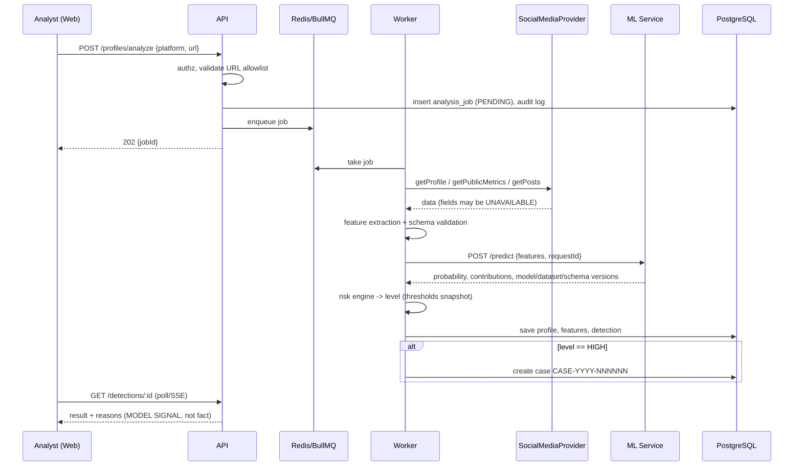

# SocialGuard AI — Architecture (v0.1, Phase 1)

## 1. Components
| Component | Tech | Responsibility |
|---|---|---|
| Web | React, TS, Vite, Tailwind, React Router | UI, form validation, role-aware routing |
| API | NestJS (TS) | Auth, RBAC, orchestration, cases, evidence, reports, audit, risk engine |
| Worker | Same codebase/image as API, different entrypoint | Consumes BullMQ jobs: fetch profile → features → ML → persist |
| ML service | FastAPI, scikit-learn, joblib | Inference only, private network |
| DB | PostgreSQL | System of record |
| Queue/cache | Redis (BullMQ) | Jobs, rate-limit counters |
| Object store | S3 (MinIO locally) | PDFs, uploaded evidence, model artifacts |
| Providers | `SocialMediaProvider`, `ReportingProvider` | Pluggable external integrations |

Training code lives in `ml-service/training/`, never in the backend.

## 2. Module boundaries (API)
`auth` · `users` · `rbac` · `profiles` · `providers` · `features` · `detections` · `risk` · `cases` · `evidence` · `reports` · `audit` · `config` · `models` · `notifications` · `health/metrics`

Layering per module: **controller → service → repository**. Controllers do no business logic; services do not touch the ORM directly.

## 3. Key sequence: analyze a profile


## 4. Key sequence: case to report
```mermaid
sequenceDiagram
  participant An as Analyst
  participant Rv as Reviewer
  participant A as API
  participant R as ReportingProvider
  An->>A: add evidence / notes
  Rv->>A: PATCH status -> APPROVED_FOR_REPORTING
  A->>A: state machine + permission + no-self-approval check
  An->>A: POST /cases/:id/report
  A->>R: submitReport()
  Note over R: ManualExportProvider returns report pack (PDF); no fake submission
  A-->>An: PDF + instructions for official channel
  An->>A: PATCH status -> REPORT_SUBMITTED (manual confirmation)
```

## 5. Failure modes
| Failure | Behavior |
|---|---|
| ML service down | Job retried with exponential backoff; after N attempts → DLQ, job `FAILED_ML`, visible in UI, retriable by analyst. No partial detection saved. |
| Provider unavailable / rate-limited | Retry respecting provider limits; fall back to ManualEntry; fields flagged `UNAVAILABLE` |
| Missing features | Pipeline uses explicit missing-indicator features; response flags reduced confidence |
| Redis down | API rejects analyze with 503; other endpoints keep working |
| DB down | Readiness probe fails; ALB drains task |
| Wrong prediction | Reviewer marks FALSE_POSITIVE; recorded as feedback label; reproducible via stored versions |

## 6. Architecture Decision Records
**ADR-1 TypeScript + NestJS.** Shared types, DI, guards for RBAC, DTO validation, OpenAPI. Trade-off: learning curve vs Express.
**ADR-2 Separate ML service.** Isolation, independent scaling/deploys, dependency hygiene. Trade-off: network hop and extra service.
**ADR-3 Async analysis via queue.** Provider calls are slow/unreliable; decouples UX from latency; enables retries. Trade-off: eventual consistency, polling.
**ADR-4 Risk levels computed in API, not ML.** Thresholds are policy, changeable without model redeploy; snapshot stored per detection.
**ADR-5 Permission-based RBAC.** Roles map to permissions in DB; code checks permissions.
**ADR-6 Provider abstraction + `UNAVAILABLE`.** Legitimate integration boundary; never invent data.
**ADR-7 Fargate for ML.** Large scientific-Python images, steady inference; Lambda container images remain a viable but not better option.
**ADR-8 Prisma ORM** *(pending confirmation).* Type-safe client and migrations.
**ADR-9 Soft delete + retention job.** Recoverable mistakes, but bounded data lifetime; audit logs excluded.

## 7. Deployment view (target)
CloudFront → S3 (web). ALB → ECS Fargate (API, Worker). ML service in private subnet, reachable only from API/Worker security group. RDS PostgreSQL, ElastiCache Redis, S3, ECR, Secrets Manager, CloudWatch. Details in Phase 16.

## 8. Cross-cutting
Request ID generated at edge, propagated to worker and ML. Structured JSON logs with redaction. Audit log written in same transaction as state changes where feasible.
