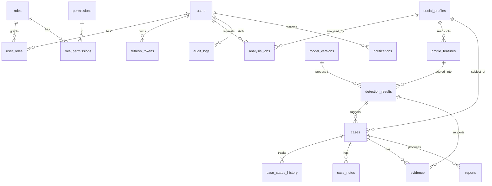

# SocialGuard AI — Database Design (Phase 3)

Source of truth: `backend/prisma/schema.prisma` (20 models, 10 enums) plus `backend/prisma/sql/integrity.sql` (rules Prisma cannot express).

## ERD (simplified)


## Design decisions
| Decision | Why |
|---|---|
| UUID PKs; separate `case_number` (`CASE-YYYY-NNNNNN`) | UUIDs are safe in URLs; humans need readable IDs. Number comes from a Postgres sequence (`next_case_number()`), so it is race-free. Counter does not reset yearly. |
| `detection_results` stores `model_version_id`, `thresholds_snapshot`, `explanations`; `model_versions` stores dataset + feature-schema versions | Every prediction is reproducible even after thresholds or models change (NFR-REPRO-1). |
| Risk **level** stored with the detection; **probability** is `numeric(6,5)` with a 0..1 CHECK | Exact decimal, no float drift; level is a policy decision frozen at prediction time. |
| `profile_features.unavailable_fields` | Fields a provider could not supply are recorded as UNAVAILABLE, never invented. |
| `social_profiles.is_demo_data` + `data_source` | DEMO and REAL AUTHORIZED data stay separable. |
| `social_profiles.metadata` is a minimal public snapshot | Privacy by design; no private data or messages. |
| Evidence has `sha256` (format CHECK), source, type, captured_at; must attach to a case or a detection | Integrity identifier + provenance; no orphan evidence. |
| `refresh_tokens` stores only a hash and a `family_id` | Rotation with reuse detection; a stolen DB dump cannot be replayed. |
| `audit_logs` append-only via trigger; `ip_hash` instead of IP | UPDATE/DELETE blocked (only the FK action that nulls `actor_id` is allowed). Retention never deletes audit rows. |
| Soft delete (`deleted_at`) on users, profiles, cases only | Recoverable mistakes. A retention job hard-deletes after the policy period (config `retention_days`). History tables, notes, evidence cascade with their case. |
| One ACTIVE model per name (partial unique index) | Prevents ambiguous "which model is live". |
| Thresholds and retention live in `system_config` | Configurable, not hardcoded. Seed never overwrites admin changes. |
| `platform_integrations.settings` holds non-secret settings only | Credentials go in Secrets Manager. The seed does not create `OFFICIAL` integrations because none exist. |

## Indexes (highlights)
`cases(status, created_at)`, partial `cases_open_idx` for open cases, `cases(assigned_*_id)`, `detection_results(risk_level, created_at)`, `detection_results(profile_id, created_at)`, `audit_logs(occurred_at)`, `audit_logs(actor_id, occurred_at)`, `audit_logs(entity_type, entity_id)`, `refresh_tokens(family_id)`, `evidence(sha256)`, unique `social_profiles(platform, handle)`.

## Applying the schema
```bash
cd backend
cp .env.example .env   # DATABASE_URL must point to a reachable Postgres
npx prisma migrate dev --name init      # generates and applies the baseline migration
npm run db:integrity                    # sequence, trigger, CHECKs, partial indexes (idempotent)
npm run db:seed                         # permissions, roles, config, integrations
```
Production/CI: `npm run db:deploy` (= `prisma migrate deploy` + integrity SQL).

Why the baseline migration isn't committed yet: Prisma generates it with its schema engine, which I could not download in my sandbox. Generate it once on your machine and commit `backend/prisma/migrations/`. The integrity SQL is deliberately not a migration, because it is idempotent and its filename ordering cannot collide with Prisma's timestamps.

## Verification status
- Schema validated with Prisma's own validator (5.22): valid.
- Domain rules (permission matrix, case state machine): unit-tested (11 tests pass).
- `integrity.sql`: parsed with the real Postgres parser (syntax OK). **Not executed against a live database yet.**
- `seed.ts`: written, **not executed**. Needs `prisma generate` and a database.
